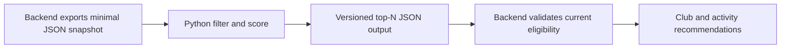

# Recommendation contract v1 — simple Python

Status: V1 Python ranking core and JSON CLI implemented in this repository, 2026-10-27. Backend export endpoints, scheduled jobs, live delivery and deployment remain proposed integration work. V1 uses Python standard-library JSON/datetime/math/collections and deterministic rules; Spark, pandas, ML training, collaborative filtering and streaming are deferred.

Examples: [input-v1.json](examples/input-v1.json), [output-v1.json](examples/output-v1.json). Related BE design is `docs/contracts/student-data-consistency-v1.md` in the `FPTU-Xperience/fptu-xperience-clubhub-api` repository (currently a local proposed design, not a verified published remote artifact). This document includes the required feed boundary so it is readable independently. Required data exports below are proposed, not existing backend APIs.

## 1. Architecture and ownership

One Python process reads a bounded snapshot, ranks each student separately and writes a result file atomically (temporary file then rename). No service credentials or SQL queries belong in ranking logic. Start with a scheduled/on-demand job and file exchange; an HTTP server is optional later. Input/output schemas are the integration boundary, not a requirement to expose a new public route.

BE owns accounts, permissions, preferences, timetables, catalog, official experience and wallet. The engine reads projections and generates advice; it cannot edit student data, grant membership, register attendance, mint credits or redeem rewards. BE performs authenticated own-user delivery and final live authorization checks. Job success does not imply publication to every account or live eligibility.

Existing AdminService activity recommendation rule `LOW_AXIS_UNROUNDED_START_ID_V1` remains available as a separately labeled baseline until an explicit integration switches it. Do not run two unlabeled ranking authorities or claim this Python design is deployed.

## 2. Minimal snapshot input

Root: `{schemaVersion:"1.0",snapshotId,asOf,expiresAt,semesterId,policyVersion,students,clubs,activities}`. UTC ISO-8601 times; `asOf <= expiresAt`, recommended initial validity 24 hours, configurable. `semesterId` is an official code, not a browser-generated alias. Snapshot creation must record actual per-source versions/asOf; unrelated services do not magically share a SQL transaction. A source observed after root asOf invalidates the batch. Stale/inconsistent required source metadata rejects that student's scoring rather than inventing fresh data.

| Dataset | Minimum fields |
| --- | --- |
| Student | `userId`, `campusCode`, `preferences:{version,interestIds,customInterests,declaredMajorCode}`, `schedule:{version,availability,busyIntervals}`, `experience:{semesterId,policyVersion,ledgerRevision,isAuthoritative,pillars}`, `memberships`, `activityRegistrations`, `walletSignals`, `sourceVersions`. |
| Club | `id`, `version`, `campusCode`, `active`, `recruiting`, `interestIds`, `majorCodes`, `pillarWeights`, `meetingIntervals`, `scheduleAvailability`. |
| Activity | `id`, `version`, `clubId`, `campusCode`, `published`, `cancelled`, `registrationOpen`, `registrationDeadline`, `capacityAvailable`, `eligibleUserIds`, `interestIds`, `majorCodes`, `pillarWeights`, `sessions`, `scheduleAvailability`. |

All existing user/club/activity IDs remain positive integers. BE exports active/unlocked eligible students only and must invalidate artifacts on account withdrawal/lock. `eligibleUserIds` is the simple v1 backend-computed eligibility projection within a bounded batch; candidates omitted for a student are ineligible, not unknown eligibility. For larger data replace it with scoped candidate partitions, not a giant user-item Cartesian join. Memberships are own approved club IDs; activityRegistrations are own registered activity IDs. `sourceVersions` includes account, catalog, preferences, schedule and experience metadata, each with version/revision and actual observation asOf; wallet metadata is required when a wallet signal is supplied. Reuse metadata exactly in output.

`pillars` contains exactly six official core axes `{pillar,score}` with score finite 0..100: Academic, Research, Global, CultureSports, Community, Entrepreneurship. BE supplies already normalized, unrounded scores under one official semester/policy and verified ledger revision. Do not compare raw point columns with different tau, re-normalize rounded UI values, or confuse spendable credits with radar axes. RealWorldWork is separate and excluded from v1 six-axis balancing.

Candidate `pillarWeights` is a nonempty map of core pillars to nonnegative finite weights summing to 1 within 1e-6; use approved activity metadata. For clubs, BE provides an explicitly curated profile; do not assign a club's entire catalog to its single label. Tagless candidates may remain but their missing feature must be explicit; malformed/non-normalized vectors are rejected, never silently guessed.

MajorCode is a controlled mapping of the student's declared major and candidate metadata, not verified roster identity. Unknown/unmapped major is null, never a guessed value from email. Custom interests are retained for future matching but v1 only scores stable canonical interest IDs. A student with only custom interests has unknown canonical-interest match, not a proven mismatch.

`busyIntervals`, club meetings and activity sessions are concrete UTC intervals over the same bounded semester/horizon with `start < end`. BE expands recurring student cells using the authoritative campus calendar and Asia/Ho_Chi_Minh timezone. Python compares intervals; it does not independently reconstruct a different semester/calendar. Sessions mark `required:true|false`; default missing required is invalid. An activity with no mandatory sessions is eligible only if at least one optional session is attendable; output the suggested optional session IDs. A mandatory session conflict excludes the activity. Ongoing/past sessions are not future opportunities.

Availability is `KNOWN|UNKNOWN`; empty KNOWN busyIntervals means the student explicitly has a known empty schedule. UNKNOWN means no reliable information, never guaranteed free time. A club with no defined meeting intervals is likewise UNKNOWN. Invalid dates fail validation; unknown availability is handled separately below.

`walletSignals` is optional own-user map keyed by club ID: `{availability,earnedTotal,revokedTotal,version}`. Amounts are safe nonnegative integers in unit CLUB_CREDIT. Real wallet may be absent because that BE contract is not implemented; use UNKNOWN. No sample 200-point balance, local ownership or FinanceService money is accepted.

## 3. Filter before scoring

Club suggestions: active and recruiting, same campus, student not already an approved member. This list means suggestions to join a club, not shortcuts to existing memberships. No membership requirement is inferred from the student's major.

Activity suggestions: published, not cancelled, future opportunity, registration open before deadline, capacity available, same campus and student included in backend eligibility; exclude already registered activities. This keeps v1 strictly campus-scoped; cross-campus/online exceptions require a later explicit eligibility contract.

With KNOWN student and activity schedules, exclude mandatory overlaps and optional-only activities with no attendable option. Intervals overlap iff `max(startA,startB) < min(endA,endB)`; back-to-back sessions are allowed with zero travel buffer in v1. A future configurable travel buffer may tighten this.

Club recurring schedule conflict is a soft compatibility score, not automatic exclusion. Missing schedule does not eliminate a candidate, but output `SCHEDULE_UNKNOWN`, never `NO_SCHEDULE_CONFLICT`. BE still rechecks current registration/capacity/access when serving or registering. Schedule predictions are not a reservation.

## 4. Deterministic scoring

These coefficients are initial engineering defaults, not empirically validated model weights. All are config values under `ruleVersion:SIMPLE_CONTENT_V1`; changing weights creates a new configVersion.

| Component | Weight | Normalized feature |
| --- | --- | --- |
| Interest fit | 0.40 | Canonical interest ID Jaccard similarity. If either set empty, unknown. Disjoint nonempty sets = 0. |
| Major fit | 0.15 | 1 when declaredMajorCode is in candidate.majorCodes, otherwise 0; unknown if either side missing. This is a preference signal, never admission eligibility. |
| Pillar direction | 0.25 | Candidate pillar vector dot normalized target weights described below. |
| Schedule fit | 0.15 | Known club meetings: fraction not overlapping busy intervals. Known surviving activity: 1. Unknown on either side: unavailable. |
| Club credit affinity | 0.05 | `min(max(earnedTotal-revokedTotal,0),1000)/1000` for the issuing club; unavailable when real wallet signal is UNKNOWN. |

Score is weighted mean over available components: `sum(weight * feature) / sum(available weights)`. Zero measured similarity stays zero; unknown is excluded, not converted into zero or free time. Output availableWeight/feature availability so sparse evidence does not masquerade as high-confidence fit. If no component is available, use deterministic catalog order with `INSUFFICIENT_PROFILE`, not a personalized score. Report score as null in that fallback.

Wallet affinity is a small optional historical involvement signal. Spending points never reduces affinity; current balance does not affect recommendations. Credit earning rules may differ across clubs, so this capped heuristic is explicitly experimental and must be evaluated before expanding its influence. Most new-club suggestions have no historical wallet signal; this does not exclude them. Do not block v1 rollout on the future wallet implementation.

### Six-axis balance

With authoritative complete radar data and a meaningful spread, give each weakest axis target weight 2.0, each strongest axis 1.5, every remaining axis 1.0. Divide all targets by their maximum (2.0) before the dot product, yielding a feature in 0..1. With unique min/max, the four remaining axes receive equal treatment. This is soft ranking influence, not a promise that any top-N list contains exact per-axis quotas.

Tie groups: axes within 1.0 score point of min/max share the respective boost. If groups overlap or `max-min <= 1.0`, use equal target values 1 for every axis. This covers new students with six zeros without inventing a weakest/strongest column. Missing/non-authoritative/incompatible-semester radar makes pillar scoring unavailable; interest/major/schedule still work. Malformed supplied authoritative axes fail the student validation. Do not turn a source outage into six zero scores.

Config defines separate club/activity limits, each integer 1..20, default 6. Within the initial ranked list, greedily cap suggestions from one activity club at 2 and one candidate dominant pillar at `ceil(limit/2)` (minimum 1). If this leaves fewer than limit, return fewer results; do not violate eligibility or secretly refill with poor/ineligible candidates. Dominant pillar tie uses canonical pillar order, recorded as a presentation tag only. Club and activity lists are ranked separately; no comparison of their numeric scores is implied. These simple caps prevent extreme repetition; equal middle-axis weights do not by themselves guarantee diverse exposure.

Sort by unrounded score DESC, availableWeight DESC, activity start ASC when applicable, then numeric ID ASC; null-score fallback goes last. Use no random seed or current clock inside scoring: asOf comes from input. Same input/config must produce identical items, features and order. Scoring all candidates per student is sufficient at v1; measure batch duration before introducing distributed tools.

## 5. Result schema and explanations

Root `{schemaVersion,snapshotId,ruleVersion,configVersion,generatedFromAsOf,expiresAt,results}`. Per user `{userId,semesterId,clubs,activities,status,warnings}`; status `READY|PARTIAL|UNAVAILABLE`. PARTIAL includes missing optional features; UNAVAILABLE is reserved for unusable required account/eligibility/catalog input. Empty eligible lists are valid READY/PARTIAL, not an exception or fake recommendation.

Each item: `{id,rank,score,availableWeight,candidateVersion,targetPillar,features,reasons,scheduleStatus,suggestedSessionIds}`. Features use `{value:null|number,available:boolean}`. Reasons are stable codes plus parameters: INTEREST_MATCH, MAJOR_MATCH, GROW_WEAKEST_PILLAR, DEVELOP_STRONGEST_PILLAR, BALANCED_EXPLORATION, NO_SCHEDULE_CONFLICT, SCHEDULE_UNKNOWN, PARTIAL_SCHEDULE_CONFLICT, CLUB_INVOLVEMENT, INSUFFICIENT_PROFILE. Club conflicts remain soft even when all known meetings overlap. Explanations reflect actual evidence; no guaranteed XP award, guaranteed admission or claims about a student's deficiencies. Warnings include PREFERENCES_UNAVAILABLE, SCHEDULE_UNKNOWN, EXPERIENCE_UNAVAILABLE, WALLET_SIGNAL_UNAVAILABLE and PARTIAL_FEATURES; malformed per-student input uses UNAVAILABLE with a validation code. Metadata may contain only version/asOf/policyVersion/ledgerRevision, with no private fields.

`targetPillar` is the dominant candidate pillar, not a claim that the event guarantees credits in that axis. Rendered labels belong to FE. Include sourceVersions/experience revision metadata with each student's result for invalidation, not raw personal schedule subjects or private wallet details in public explanations.

Snapshot expires or preferences/schedule/membership/catalog versions change: BE marks output stale, refilters and requests recomputation. V1 may return fewer results or an explicit unavailable state while waiting; never claim that stale ordering has incorporated a newly edited preference/schedule. BE stores results with per-user access control. Engine outputs are not public/static assets readable by other students.

## 6. Data minimization and execution

Only opaque internal user ID and necessary tags, coarse declared major, busy intervals and aggregate features cross this boundary. Exclude email, phone, address, birth date, subject/room names, evidence, auth tokens, raw wallet ledger and profile images. Job logs contain batch counts/errors, not student records. Retain snapshots/results only under a deployment-configured bounded retention policy; disable withdrawn accounts and delete/recompute their artifacts when BE signals removal. Never commit real student export files.

Implemented CLI: `python -m recommendation_engine --input snapshot.json --output recommendations.json --config config.json`. It checks current UTC expiration; explicit `--evaluation-time <UTC>` enables offline fixture replay. Pure `recommend()` omits wall-clock expiration unless evaluated_at is supplied; live callers must provide it or use the CLI. Nonzero exit on invalid root/config or failed output publication; per-user validation failures produce UNAVAILABLE with structured codes and no fabricated items. Validate unique user/candidate IDs, cardinality bounds and matching snapshot versions before scoring. Duplicate JSON keys and NaN/Infinity are invalid. Missing optional objects may be null; supplied source metadata must be valid/fresh even when the feature is unavailable. A future source observation fails the batch. Activities with any already-started mandatory session, or no future session at all, are excluded because participation cannot be satisfied/proven from this snapshot.

Configuration: [default.json](../../config/default.json). Changed settings require a distinct configVersion. Limits 1..20; all five nonnegative weights must sum to 1; boosts are positive and <=100, tie tolerance 0..100, affinity cap a positive safe integer, maxSourceAgeHours 0.01..168 (default 24). Coefficients are adjustable but still heuristic. Output candidate vectors are normalized only for accepted 1e-6 summation tolerance; invalid/non-normalized vectors are rejected.

## 7. Acceptance and incremental enhancement

V1 tests must cover: no student history; all radar axes equal/zero; tied extrema; missing major/interests; malformed policy/vector; schedule UNKNOWN vs known empty; boundary/nonboundary overlap; mandatory and optional sessions; different campus; private/closed/cancelled/full activity; existing member/registered event; duplicate IDs; missing wallet vs real zero; spending changes balance but not affinity; deterministic ranks; sparse candidates; per-club/axis caps; stale snapshot; account isolation; atomic output failure. Fixtures are synthetic only.

Evaluate against the existing lowest-axis rule and an interest-only baseline. Start with human-reviewed relevance, zero known mandatory schedule conflicts, registration/attendance conversion, recommendation coverage, per-axis exposure and repetition. Do not present click-through alone as success or fit coefficients on future attendance data. Log impressions before treating lack of engagement as feedback.

Enhancement order: (1) implement pure functions + JSON CLI and tests; (2) automate BE exports/result delivery and version-triggered recomputation; (3) collect exposure/registration/attendance feedback and tune coefficients; (4) improve text/major mappings and repeat-time availability; (5) only introduce pandas, an API worker, learned ranking or PySpark when measured workload/quality calls for it. Preserve schemaVersion/ruleVersion/configVersion and source provenance through each upgrade.
